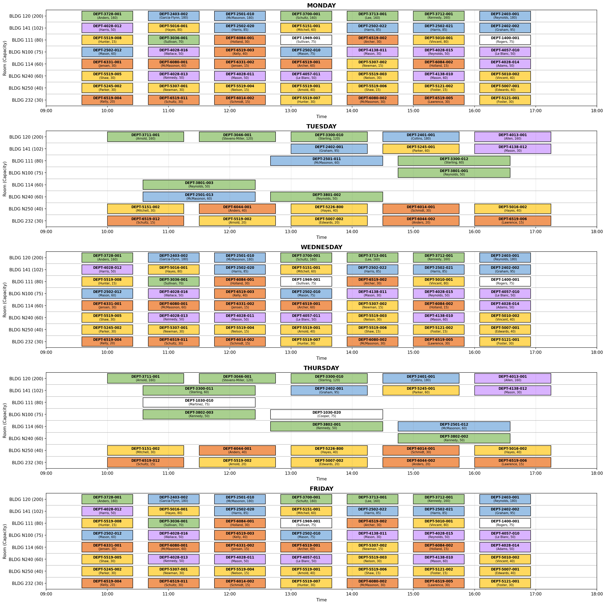

# satisfaculty

**[View on GitHub](https://github.com/CU-AES-Operations/satisfaculty)**

Are you a faculty member or administrator trying to create a schedule that obeys tricky constraints and satisfies many objectives? Satisfaculty can help!

`satisfaculty` is a python package that uses lexicographic mixed-integer linear programming to create academic schedules like the one below:



## Installation

```bash
pip install satisfaculty
```

## Quick Start

```python
from satisfaculty import *

scheduler = InstructorScheduler()

scheduler.load_rooms('rooms.csv')
scheduler.load_courses('courses.csv')
scheduler.load_time_slots('time_slots.csv')

# Add constraints (required for a valid schedule)
scheduler.add_constraints([
    AssignAllCourses(),
    NoInstructorOverlap(),
    NoRoomOverlap(),
    RoomCapacity(),
    ForceRooms(), # You can always manually override!
    ForceTimeSlots()
])

objectives = [
    MinimizeMinutesAfter('17:00'),
    MinimizeClassesBefore("9:00"),
]
scheduler.lexicographic_optimize(objectives)
scheduler.visualize_schedule()
```

This will output the schedule above.

## Example

Example data files and a script are available in the [`example/`](https://github.com/CU-AES-Operations/satisfaculty/tree/main/example) directory of the repository.

## Contents

```{toctree}
:maxdepth: 2

formulation
objectives_guide
debugging
```
